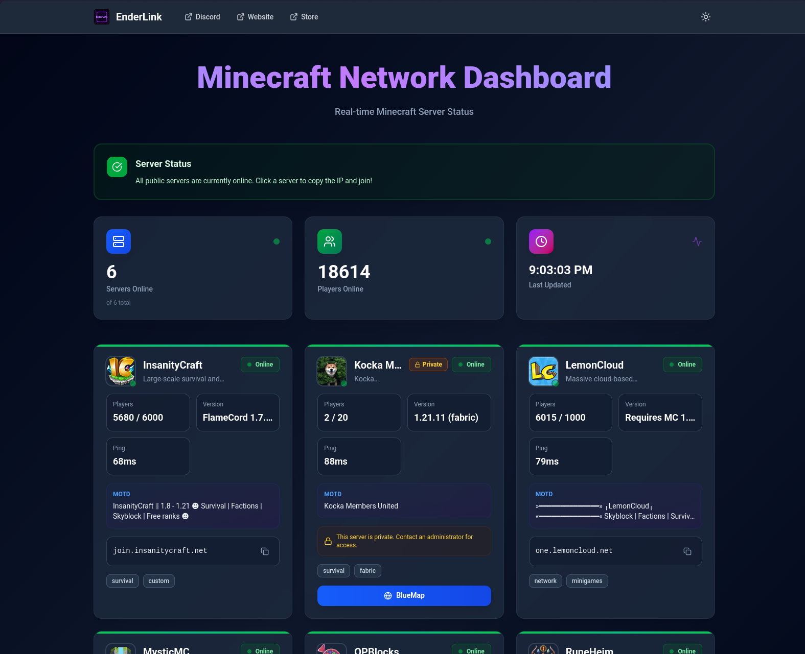

# EnderLink

A "Homer-style" reusable Minecraft welcome dashboard built with TanStack Start. EnderLink provides a public, read-only dashboard showing server status, player counts, versions, MOTD, and optional links.




## Features

- **Server Status Monitoring**: Real-time status for multiple Minecraft servers
- **Dashboard View**: Clean, modern UI showing server information at a glance
- **Auto-refresh**: Automatically polls servers and updates the dashboard
- **Docker Ready**: Single Docker image, runnable anywhere
- **YAML Configuration**: Simple YAML-based configuration from mounted volume
- **No Auth Required**: Public dashboard, no authentication needed
- **Smart Caching**: Prevents hammering servers with intelligent caching

## Quick Start

### 1. Create Configuration

Create a `config` directory with a `config.yaml` file:

```bash
mkdir config
cp config/config.example.yaml config/config.yaml
```

Edit `config/config.yaml` with your server details (see [Configuration](#configuration) below).

### 2. Run with Docker

**Using Docker Compose (recommended):**

```bash
docker-compose -f docker-compose.example.yml up -d --build
```

This will build the image from source. If you prefer to use a pre-built image from Docker Hub, edit `docker-compose.example.yml` and comment out `build: .` while uncommenting `image: kbalinthunor/enderlink:latest`.

**Using Docker directly:**

```bash
docker build -t kbalinthunor/enderlink:latest .
docker run -d \
  -p 3000:3000 \
  -v $(pwd)/config:/config:ro \
  --name enderlink \
  kbalinthunor/enderlink:latest
```

The dashboard will be available at `http://localhost:3000`

### 3. Environment Variables (Optional)

- `ENDERLINK_CONFIG_DIR`: Config directory path (default: `/config`)
- `ENDERLINK_CONFIG_FILE`: Config filename (default: `config.yaml`)
- `PORT`: Server port (default: `3000`)

Example:

```bash
docker run -d \
  -p 8080:8080 \
  -v $(pwd)/config:/config:ro \
  -e PORT=8080 \
  -e ENDERLINK_CONFIG_DIR=/config \
  -e ENDERLINK_CONFIG_FILE=config.yaml \
  kbalinthunor/enderlink:latest
```

## Configuration

The configuration file (`config.yaml`) defines your dashboard title, polling interval, links, and server list.

### Example Configuration

```yaml
title: "EnderLink Server Dashboard"
pollIntervalMs: 5000

links:
  - title: "Discord"
    url: "https://discord.gg/example"
  - title: "Rules"
    url: "https://example.com/rules"
  - title: "Store"
    url: "https://store.example.com"

# Optional custom message box
message:
  title: "Welcome!"
  content: "Join our community Discord for updates and support. All servers are running smoothly!"
  type: "info"  # Options: info, warning, success, error

servers:
  - id: "survival"
    displayName: "Survival Server"
    description: "Our main survival world"
    host: "mc.example.com"
    port: 25565
    version: "1.21.11 (vanilla)"
    bluemapUrl: "https://map.example.com"
    websiteUrl: "https://example.com"
    tags:
      - "survival"
      - "vanilla"
    private: false

  - id: "creative"
    displayName: "Creative Server"
    description: "Build and create freely"
    host: "creative.example.com"
    port: 25565
    tags:
      - "creative"
      - "building"
    private: false
```

### Configuration Schema

- `title` (string, required): Dashboard title displayed at the top
- `pollIntervalMs` (number, 1000-60000, default: 5000): How often to poll servers (milliseconds)
- `links` (array, optional): Global links shown in the navbar
  - `title` (string, required): Link display name
  - `url` (URL, required): Link URL
- `message` (object, optional): Custom message box displayed on dashboard
  - `title` (string, optional): Message title
  - `content` (string, required): Message content
  - `type` (string, optional): Message type - `info`, `warning`, `success`, or `error` (default: `info`)
- `servers` (array, required, min 1): List of Minecraft servers
  - `id` (string, required): Unique server identifier
  - `displayName` (string, required): Name shown on dashboard
  - `description` (string, optional): Server description
  - `host` (string, required): Server hostname or IP
  - `port` (number, 1-65535, optional, default: 25565): Server port
  - `version` (string, optional): Server version (overrides status version if provided)
  - `bluemapUrl` (URL, optional): BlueMap link for this server
  - `websiteUrl` (URL, optional): Website link for this server
  - `tags` (array of strings, optional): Tags displayed on server card
  - `private` (boolean, optional, default: false): If true, hides join address from public view

## Development

### Prerequisites

- Node.js 24+ or Bun 1.3+
- npm or bun

**Note**: The Docker image uses Bun 1.3 for faster builds and runtime performance.

### Install Dependencies

```bash
npm install
# or
bun install
```

### Run Development Server

```bash
npm run dev
# or
bun run dev
```

The app will be available at `http://localhost:3000`

### Build for Production

```bash
npm run build
# or
bun run build
```

### Preview Production Build

```bash
npm run preview
# or
bun run preview
```

## Architecture

- **Config System**: YAML-based configuration with Zod validation and mtime-based reload caching
- **Minecraft Status**: Uses `node-mcstatus` to query Java Edition servers via the mcstatus.io API
- **Server-Side Rendering**: All data fetching happens server-side using TanStack Start's server functions
- **Caching**: Summary is cached for `pollIntervalMs` to prevent server hammering
- **Error Handling**: Individual server failures don't break the entire dashboard
- **Modern UI**: Built with Tailwind CSS v4, featuring glassmorphism effects and smooth animations
- **Dark Mode**: Automatic dark mode support with manual toggle

## Technical Details

- **Framework**: TanStack Start (React + Vite + Nitro)
- **Runtime**: Bun 1.3+ (via Docker) or Node.js 20+
- **Styling**: Tailwind CSS v4 with custom animations
- **Icons**: Lucide React
- **Validation**: Zod schema validation for configuration

## Notes

- This is a **public dashboard** with no authentication required
- Configuration is loaded from a mounted volume at runtime
- The app automatically reloads configuration when the file changes (mtime-based)
- Server polling happens server-side using React Server Components; no API calls visible in browser network tab
- Individual server failures are handled gracefully and don't affect other servers
- Offline servers are automatically sorted to the end of the server list
- Server icons are automatically fetched and displayed when available

## License

See LICENSE file for details.
